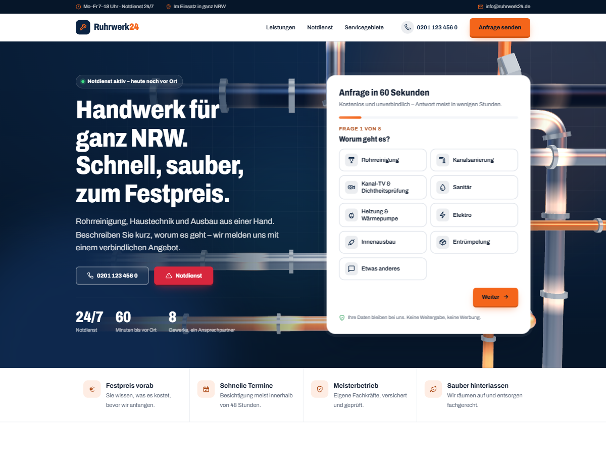

# Ruhrwerk24 – WordPress-Theme

Theme für einen Handwerks- und Notdienstbetrieb in NRW: Rohrreinigung, Haustechnik, Ausbau. Mit 3D-Rohrnetz im Seitenkopf, mehrstufigem Anfrageformular und automatischen Stadt-Landingpages.

**Live-Demo:** https://contactnasriimen-ctrl.github.io/ruhrwerk24-theme/
(statische Kopie – Kontaktdaten sind Platzhalter, das Formular sendet nichts)

**Download:** installierbares ZIP unter [Releases](https://github.com/contactnasriimen-ctrl/ruhrwerk24-theme/releases/latest)



## Funktionen

- **3D-Seitenkopf** (Three.js, lokal eingebunden): Metallrohre mit Flanschen, die beim Laden „wachsen“, orangefarbene Strömung, schwebende Muttern; reagiert auf Maus und Scrollen. Wird erst nach dem Seitenaufbau geladen, pausiert außerhalb des Sichtbereichs und entfällt auf schwachen Geräten, bei Datensparmodus und bei „Bewegung reduzieren“.
- **3D-Oberfläche:** Karten kippen zur Maus mit Lichtreflex, Überschriften bauen sich Wort für Wort auf, Abschnitte klappen beim Scrollen ins Bild, Knöpfe mit Tiefe.
- **Anfrageformular in acht Schritten** ohne Plugin und ohne Captcha (Honeypot, signierter Zeitstempel, Limit pro IP). Funktioniert auch ohne JavaScript.
- **Anfragen im Backend:** Status, interne Notiz, CSV-Export, automatische Löschung nach X Monaten (DSGVO), Bestätigungsmail mit Anfragenummer.
- **Stadtseiten ohne Datenbankeinträge:** `/rohrreinigung-essen/` und `/servicegebiete/essen/` für 27 Städte, mit eigenen Inhalten je Stadt und in der XML-Sitemap.
- **SEO:** Meta-Description, Open Graph, Canonical, Schema.org (LocalBusiness, Service, FAQ, Breadcrumbs). Zieht sich bei Yoast, Rank Math oder SEOPress zurück.
- **Datenschutz:** keine externen Anfragen, keine Cookies, kein jQuery, Schrift lokal.
- **Einrichtung per Klick:** Beim Aktivieren entstehen Leistungen, Seiten und Menüs.

## Installation

1. ZIP aus den [Releases](https://github.com/contactnasriimen-ctrl/ruhrwerk24-theme/releases/latest) unter *Design › Themes › Theme hinzufügen* hochladen und aktivieren.
2. *Design › Customizer › Ruhrwerk24*: Kontaktdaten, Farben, Texte eintragen.
3. Impressum und Datenschutzerklärung ausfüllen, Fotos als Beitragsbilder der Leistungen hinterlegen.
4. Für zuverlässigen Mailversand ein SMTP-Plugin einrichten.

Voraussetzungen: WordPress 6.4+, PHP 8.0+.

## Aufbau

```
ruhrwerk24/          das Theme
  inc/               Logik (Inhaltstypen, Formular, Anfragen, Städte, SEO, Sitemap)
  template-parts/    wiederverwendbare Bausteine
  templates/         Stadtseiten
  assets/js/hero3d.js  3D-Szene
docs/                statische Demo für GitHub Pages
scripts/
  build-zip.php      installierbares ZIP nach dist/
  build-demo.php     Demo aus einer lokalen WordPress-Installation nach docs/
```

Demo neu bauen (lokales WordPress mit aktivem Theme vorausgesetzt):

```
php scripts/build-demo.php http://localhost:8124 https://contactnasriimen-ctrl.github.io/ruhrwerk24-theme https://github.com/contactnasriimen-ctrl/ruhrwerk24-theme
```

## Lizenzen

Theme: GPL-2.0-or-later · Three.js: MIT · Schrift Archivo: SIL Open Font License 1.1

Entwickelt von [Over-Tech.de](https://over-tech.de).
